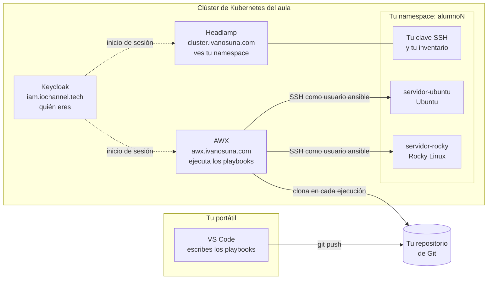

# AU294 — Automatización de Red Hat Enterprise Linux con Ansible

## Bienvenida

Hola, bienvenido o bienvenida al curso. Soy Iván Osuna y voy a ser tu formador
esta semana.

Durante cinco días vamos a aprender a automatizar la administración de
sistemas Linux con Ansible. Empezamos por el primer *playbook* y llegamos a
roles, colecciones y tareas reales de administración. No hace falta que sepas
nada de Ansible. Sí conviene que te muevas con soltura por una terminal Linux.

En este repositorio tienes todo lo del curso: el temario, los ficheros con los
que vamos a trabajar, las notas de cada día y, sobre todo, **cómo es y cómo se
usa el laboratorio**. Léelo con calma antes de empezar o durante la primera
mañana.

| Dato           | Valor                                         |
|----------------|-----------------------------------------------|
| Fechas         | Del lunes 19 al viernes 23 de octubre de 2026 |
| Horario        | De 9:00 a 14:00                               |
| Temario        | [notas/temario.md](notas/temario.md)          |
| Notas de clase | [notas/](notas/), un fichero por día          |

**No tienes que instalar Ansible en tu portátil.** El laboratorio está en un
clúster de Kubernetes y se usa desde el navegador. Si además quieres ejecutar en
local, al final del documento se explica cómo, pero es opcional.

---

## Cómo es el laboratorio

### Lo que tienes montado

Cada alumno tiene su propio espacio, separado del de los demás.

| Qué                     | Lo tuyo                                                              |
|-------------------------|----------------------------------------------------------------------|
| Usuario                 | `alumnoN`. Búscate en la tabla de abajo                              |
| Dos máquinas Linux      | `servidor-rocky` y `servidor-ubuntu`                                 |
| Un sitio donde ejecutar | Tu organización en AWX, con tu inventario y tu credencial ya puestos |
| Espacio en Kubernetes   | Un *namespace* con tu nombre (`alumnoN`)                             |
| Tres bases de datos     | `alumnoN_dev`, `alumnoN_test` y `alumnoN_pro`                        |

### Tu usuario

| Usuario    | Alumno            |
|------------|-------------------|
| `alumno1`  | Kevin T.          |
| `alumno2`  | Salima E.         |
| `alumno3`  | David P.          |
| `alumno4`  | José G.           |
| `alumno5`  | Guillermo G.      |
| `alumno6`  | Sergio O.         |
| `alumno7`  | David A.          |
| `alumno8`  | Ismael R.         |
| `alumno9`  | Laura Al.         |
| `alumno10` | Antonio Manuel G. |
| `alumno11` | Alejandro G.      |
| `alumno12` | Raúl S.           |
| `alumno13` | Óscar G.          |
| `alumno14` | Francesc V.       |
| `alumno15` | Laura Ar.         |
| `alumno16` | Fernando D.       |

### Arquitectura



Las piezas, una a una:

- **Keycloak** guarda tu identidad. Entras con el mismo usuario y la misma
  contraseña en AWX y en Headlamp.
- **AWX** ejecuta tus *playbooks*. Es el proyecto de código abierto del que sale
  el *automation controller* de Red Hat Ansible Automation Platform, así que lo
  que aprendas aquí te vale allí. Cada vez que lanzas un trabajo, AWX vuelve a
  clonar el repositorio, de modo que siempre ejecuta lo último que hayas subido.
- **Tus dos máquinas** son contenedores que se comportan como servidores: tienen
  SSH, Python y un usuario `ansible` que puede hacer `sudo` sin contraseña. Es lo
  que Ansible necesita para trabajar. AWX entra en ellas por SSH con **tu propia
  clave**, que no es la de ningún compañero.
- **Headlamp** te enseña tu *namespace* de Kubernetes. Ahí tienes tu clave SSH
  (el secreto `ansible-clave`) y tu inventario ya relleno (el ConfigMap
  `ansible-inventario`). Sólo los necesitas si ejecutas en local.

### Por qué está montado así

**Las máquinas se llaman igual para todos, y es a propósito.** Un *playbook*
escrito contra `servidor-rocky` funciona en el entorno de cualquiera sin cambiar
nada. Lo que cambia por debajo es la máquina a la que apunta ese nombre:

```
servidor-rocky   ->   servidor-rocky.alumnoN.svc.cluster.local
```

En el inventario, el alias (`servidor-rocky`) es igual para todos, y la variable
`ansible_host` apunta a tu *namespace*. Así podemos compartir código en clase sin
que nadie tenga que adaptarlo.

**Son Rocky Linux y Ubuntu a propósito.** Rocky es compatible con Red Hat
Enterprise Linux, y Ubuntu es de la familia Debian. Casi todo lo que veremos
sobre condicionales, *facts* y módulos que dependen de la distribución se
practica mejor con las dos delante.

**Tu espacio está aislado de la red.** Tus máquinas pueden salir a Internet a
descargar paquetes y AWX puede llegar a ellas, pero no pueden llegar al resto
del clúster. Rompe lo que quieras: no afecta a nadie más.

---

## Dónde se entra

| Para qué                          | Dirección                     |
|-----------------------------------|-------------------------------|
| Ejecutar tus *playbooks*          | https://awx.ivanosuna.com     |
| Ver tu espacio en Kubernetes      | https://cluster.ivanosuna.com |
| Tu identidad                      | https://iam.iochannel.tech    |
| Bases de datos desde el navegador | https://bbdd.ivanosuna.com    |

**Las tres primeras usan el mismo usuario y la misma contraseña.** El usuario es
`alumnoN`. La contraseña te la digo en clase el primer día. No está escrita en
ningún sitio de este repositorio y no tienes que cambiarla.

Si se te olvida, pídemela. No la busques en el material.

---

## Qué hay en cada carpeta

```
proyectos/
  ejemplo/                  el primer playbook, para comprobar que todo va
  entornos-de-ejecucion/    cómo se empaqueta Ansible en un contenedor
  ansible-navigator.yml     configuración para ejecutar en local (opcional)

notas/
  temario.md                el temario del curso
  dia1.md ... dia5.md       los apuntes de clase, día a día
```

### `proyectos/ejemplo/`

Son tres ficheros y los tres hacen falta:

- **`inventario.ini`** dice cuáles son tus máquinas. Verás que los nombres son
  alias y que `ansible_host` apunta a la máquina real.
- **`ansible.cfg`** es la configuración. Lleva `host_key_checking = False`
  porque las máquinas del laboratorio regeneran su clave cada vez que arrancan, y
  sin esa línea cada conexión daría un aviso. **En producción no se hace nunca**,
  y en clase veremos por qué.
- **`playbook-prueba.yml`** no cambia nada en las máquinas. Sólo comprueba que
  Ansible conecta, que recoge los datos del sistema y que distingue Rocky de
  Ubuntu. Es lo primero que vas a ejecutar.

### `proyectos/entornos-de-ejecucion/`

Un *execution environment* (entorno de ejecución) es un contenedor que lleva
dentro Ansible y todo lo que necesita. En lugar de instalar Ansible, se
construye una imagen y se ejecuta dentro de ella. Así todo el mundo ejecuta
exactamente lo mismo.

Hay dos, y la diferencia importa:

- **`basico/`** es con el que empezamos: `ansible-core` y poco más.
- **`avanzado/`** es al que llegaremos, añadiendo colecciones y paquetes a
  medida que hagan falta.

**Ése es el ejercicio**: el entorno de ejecución también es código. Se versiona y
se vuelve a construir cuando cambia. No es un detalle de la instalación.

---

## Cómo se trabaja

El circuito del curso es éste, y es el mismo que usarías en una empresa:

```
escribes en tu portátil  ->  subes a tu repositorio de Git  ->  AWX lo ejecuta
```

1. **Escribes** tus *playbooks* en el editor que prefieras: VS Code, vim o
   cualquier otro.
2. **Los subes** a tu repositorio de Git.
3. **AWX los ejecuta** contra tus máquinas. Allí tienes tu propia organización,
   con tu inventario (`alumnoN-laboratorio`) y tus dos máquinas ya dadas de alta
   en el grupo `servidores`.

No tienes que configurar el inventario: ya está puesto y apunta a tus máquinas.

### Lo que necesitas en tu portátil

Poca cosa, y seguramente ya lo tienes:

- **Un editor de texto.** VS Code va bien, con la extensión de Ansible de Red
  Hat. Cualquier otro editor también sirve.
- **Git**, para subir tu trabajo.
- **Un navegador.**

No hace falta instalar Ansible.

### Si además quieres ejecutar en local (opcional)

Se puede, y a partir de cierto momento del curso es cómodo para probar sin subir
nada. Necesitas:

- **Podman o Docker**, para el entorno de ejecución.
- **`ansible-navigator`**: `pip install ansible-navigator`.
- **Tu clave SSH.** La sacas de tu espacio en Kubernetes y la guardas en
  `~/.ssh/aula` con permisos `600`. Lo vemos en clase.

`proyectos/ansible-navigator.yml` ya está configurado para eso: monta tu clave
dentro del contenedor y usa el entorno básico.

```bash
cd proyectos
ansible-navigator run ejemplo/playbook-prueba.yml
```

---

## La primera comprobación

Antes de escribir nada, lanza el *playbook* de prueba. Si sale bien, el
laboratorio está completo y puedes empezar.

Te tiene que decir qué sistema operativo tiene cada máquina. Si eso funciona,
funciona todo lo demás: la conexión, las credenciales, los permisos y la red.

**Si falla, no pierdas tiempo peleándote con ello.** Avísame y lo miramos. El
primer día es cuando salen los problemas del laboratorio, y lo más probable es
que sea cosa del laboratorio y no tuya.

---

## Cosas que te van a pasar, y por qué

**«No conecta con la máquina».** Lo más habitual el primer día es la clave SSH:
tiene que estar en `~/.ssh/aula` y con permisos `600`. Si cualquiera puede
leerla, SSH la rechaza, y el mensaje de error no siempre lo deja claro.

**«A mí me funciona y a mi compañero no».** Cada uno tiene sus propias máquinas.
Si le pasas un *playbook* a alguien, le funcionará, porque los nombres son los
mismos. Si le pasas tu *inventario*, no le funcionará, porque ése sí apunta a
tus máquinas.

**«El trabajo sale en verde pero no ha hecho nada».** Mira si pone
`skipping: no hosts matched`. Significa que el `hosts:` de tu *playbook* no
coincide con ningún equipo ni grupo del inventario. Ansible no lo considera un
error, pero no se ha conectado a nada.

**«He roto mi máquina».** No pasa nada, para eso está. Avísame y la
reconstruimos en un minuto. Es un laboratorio, no un servidor de producción:
rómpelo, que así es como se aprende.

**«Se me ha borrado lo que tenía».** Lo que esté en tu repositorio de Git
sobrevive a todo. Lo que esté sólo dentro de una máquina, no. Sube tu trabajo.

---

## Al terminar el curso

El laboratorio se desmonta y las máquinas desaparecen. **Tu repositorio de Git es
tuyo y te lo quedas**, con todo lo que hayas escrito.

Sube lo que quieras conservar antes del último día.
